# 🎯 AI Job Search Agent

### An agent that finds real fresher jobs, scores each one against my resume with Gemini, and tracks my applications

<p align="center">
  
  
  
  
  
</p>

---

## 📌 Why I built this

As a 2026 fresher I was spending hours a day scrolling job boards, and most postings were not even for freshers ("3–5 years required"). This agent does that work for me: it pulls new postings from job APIs, throws out the ones that need experience, asks Gemini how well each remaining job fits my profile, and shows me a ranked list with the exact skills I match and the ones I'm missing.

## ✨ Features

- 🔎 **Real job data** from the Adzuna and JSearch (Google for Jobs) APIs — no scraping
- 🧹 **Fresher filter** — drops senior titles and postings that ask for more than 1 year of experience before any LLM call
- 🔁 **De-duplication** — the same job posted on two sites is shown once (company + title matching)
- 🧠 **Gemini match scoring** — 0–100 score, verdict, matching skills, missing skills and which resume version to send
- 🗄️ **SQLite tracking** — you only ever see a job once; mark it applied ✅, saved ⭐ or skipped ✖️
- 📊 **Streamlit dashboard** — filters, score bars, CSV export
- 📲 **Telegram alerts** — top new matches sent to your phone
- 🧪 **Demo mode** — try everything offline with sample data, no API keys needed

## 🏗️ How it works

```mermaid
flowchart LR
    subgraph FETCH["📥 Fetch"]
        direction TB
        A(["🌐 Adzuna API"])
        B(["🌐 JSearch API"])
    end

    FETCH --> C["🧹 Clean HTML"]
    C --> D["🔁 De-duplicate"]
    D --> E[("🗄️ Seen before?")]
    E -->|new| F{"🧑‍🎓 Fresher filter"}
    F -->|"too senior"| G["⛔ Saved as filtered"]
    F -->|ok| H["🧠 Gemini scoring"]
    H --> I[("💾 SQLite")]
    I --> J["📊 Streamlit dashboard"]
    I --> K["📲 Telegram alert"]

    classDef api fill:#6C5CE7,stroke:#4834D4,stroke-width:2px,color:#fff
    classDef step fill:#74B9FF,stroke:#0984E3,stroke-width:2px,color:#2D3436
    classDef db fill:#FFB000,stroke:#C98A00,stroke-width:2px,color:#2D3436
    classDef filter fill:#FDCB6E,stroke:#E17055,stroke-width:2px,color:#2D3436
    classDef drop fill:#D63031,stroke:#8E1E1E,stroke-width:2px,color:#fff
    classDef llm fill:#0984E3,stroke:#065A9E,stroke-width:3px,color:#fff
    classDef out fill:#00B894,stroke:#00866B,stroke-width:2px,color:#fff

    class A,B api
    class C,D step
    class E,I db
    class F filter
    class G drop
    class H llm
    class J,K out
    style FETCH fill:#F3F0FF,stroke:#6C5CE7,stroke-width:2px,stroke-dasharray:5 5,color:#2D3436
    linkStyle default stroke:#636E72,stroke-width:2px
```



## 📂 Project structure

```text
ai-job-search-agent/
├── app.py               # Streamlit dashboard
├── profile.md           # your profile — the AI scores jobs against this
├── requirements.txt
├── .env.example         # copy to .env and add your keys
├── data/
│   └── demo_jobs.json   # offline sample data for demo mode
└── src/
    ├── settings.py      # search queries, locations, thresholds
    ├── fetchers.py      # Adzuna + JSearch API clients
    ├── filters.py       # fresher filter + de-duplication
    ├── scorer.py        # Gemini scoring (keyword fallback without a key)
    ├── db.py            # SQLite storage and status tracking
    ├── notifier.py      # Telegram alerts
    └── agent.py         # the pipeline: fetch → filter → score → store → notify
```

## 🚀 Setup

```bash
git clone https://github.com/AkhilReddySankati/ai-job-search-agent.git
cd ai-job-search-agent
python -m venv .venv
.venv\Scripts\activate          # Windows  (macOS/Linux: source .venv/bin/activate)
pip install -r requirements.txt
```

**Try it immediately (no keys):**

```bash
streamlit run app.py            # keep "Demo mode" on and click "Search now"
```

**Use real jobs:** copy `.env.example` to `.env` and add your free keys:

| Key | Where to get it |
|---|---|
| `ADZUNA_APP_ID`, `ADZUNA_APP_KEY` | [developer.adzuna.com](https://developer.adzuna.com) |
| `RAPIDAPI_KEY` | [rapidapi.com](https://rapidapi.com) → subscribe to **JSearch** (free tier) |
| `GEMINI_API_KEY` | [aistudio.google.com/apikey](https://aistudio.google.com/apikey) |
| `TELEGRAM_BOT_TOKEN`, `TELEGRAM_CHAT_ID` | optional — create a bot with @BotFather |

You only need one job API to start. Without a Gemini key the agent falls back to keyword scoring.

Then run from the dashboard, or from the terminal:

```bash
python -m src.agent             # real search + Telegram alert
python -m src.agent --demo      # sample data
```

**Run it daily automatically:** Windows Task Scheduler or a cron job running `python -m src.agent` every morning.

## ⚙️ Customise

Edit `src/settings.py` for search queries, cities (JSearch has its own shorter list because its free plan allows about 200 requests a month), how old postings can be, the experience limit and the alert threshold. Edit `profile.md` with your own skills and projects — that is what Gemini compares every job against.

## 🔬 Design decisions

- **APIs over scraping:** job boards block scrapers and forbid it in their terms; APIs are stable and legal.
- **Rules before the LLM:** the regex experience filter removes most unsuitable jobs for free, so Gemini is only called on real candidates (saves quota and time).
- **Remember filtered jobs too:** rejected postings are stored with status `filtered`, so they are never re-checked on the next run.
- **JSON-mode LLM output:** Gemini returns a fixed JSON shape, which is validated and capped (e.g. score is limited to 30 when the model says experience doesn't fit).

## 🗺️ Future enhancements

- [ ] Resume-gap report: keywords most often missing across all saved jobs
- [ ] Auto-tailored cover-letter draft for a selected job
- [ ] More sources (company career pages via Greenhouse / Lever public APIs)
- [ ] Docker + GitHub Actions for a free daily cloud run

## 👨‍💻 Author

**Akhil Reddy Sankati** — B.Tech CSE (2026)
🔗 [GitHub](https://github.com/AkhilReddySankati) · [LinkedIn](https://www.linkedin.com/in/akhil-reddy-sankati-datascientist/) · 📧 akhilreddysankati1328@gmail.com
